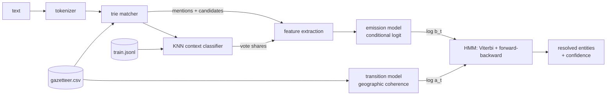

# georesolve-cpp

A toponym disambiguation engine in C++17: it finds place names in text and resolves each one to a gazetteer entry, using a Hidden Markov Model over candidate sequences, KNN context similarity and a calibrated combination of features.


```
$ georesolve "I flew from Naples to Rome, then drove to Florence."
Naples   -> Naples, CAM, IT     naples-it     lat 40.85 lon  14.27  conf 0.97  (2 candidates)
Rome     -> Rome, LAZ, IT       rome-it       lat 41.90 lon  12.50  conf 1.00  (3 candidates)
Florence -> Florence, TOS, IT   florence-it   lat 43.77 lon  11.25  conf 0.97  (5 candidates)
```

## What it demonstrates

- **Gazetteer matching with a token trie.** Primary and alternate names (`Napoli`, `St. Louis`, `New York City`) are indexed as token sequences; the longest match wins and accents are folded (`Córdoba` matches `Cordoba`).
- **Candidate features.** A population prior, explicit qualifiers (`Paris, Texas`), containment and country agreement with unambiguous mentions elsewhere in the text, and haversine proximity to them.
- **KNN context classification.** Each labelled training mention becomes a TF-IDF vector of its sentence; a new mention is compared by cosine to the training contexts of its own candidates, and the top k vote with similarity weights.
- **Calibrated feature combination.** A conditional logit (softmax over candidates) learns how much to trust each feature. Context scores used for training are computed leave-one-document-out, so the model learns how reliable KNN is on unseen text, not on text it has memorized.
- **HMM decoding.** Hidden states are the candidates of each mention, emissions come from the calibrated model, transitions reward geographic coherence. Viterbi gives the joint assignment, forward-backward gives per-mention confidence.
- **Evaluation harness.** Held-out accuracy against population-only and KNN-only baselines, plus an ablation of the transition model.

## Architecture



The library (`include/georesolve`, `src`) is split along the pipeline: `tokenizer`, `trie` and `matcher` produce mentions; `tfidf` and `knn` score context; `features` builds the feature vectors and holds the emission model; `transitions` and `hmm` do sequence decoding; `resolver` wires the stages together and owns training; `evaluation` runs the benchmark. The HMM code knows nothing about geography: it takes log emission vectors and log transition matrices whose size can change at every step, which is what a sequence of mentions with different candidate counts needs.

### The model

For mentions $m_1 \dots m_T$ with candidate sets $C_1 \dots C_T$, the decoder picks

$$
\hat{y}_{1:T} = \arg\max_{y_t \in C_t} \; \sum_{t=1}^{T} \log b_t(y_t) \;+\; \beta \sum_{t=2}^{T} \log a(y_{t-1}, y_t)
$$

**Emissions.** For candidate $c$ of mention $t$ with feature vector $f_t(c)$:

$$
b_t(c) = \frac{\exp(w^\top f_t(c))}{\sum_{c' \in C_t} \exp(w^\top f_t(c'))}
$$

Features: relative log population, log KNN vote share, qualified-by / qualifies (`Paris, Texas`), an anchor area contains the candidate, the candidate contains an anchor, an anchor shares its country, $-\log_{10}(1 + d/50\,\text{km})$ to the nearest anchor point, and an is-area flag. An anchor is any mention with exactly one candidate. $w$ is fit by gradient ascent on the log-likelihood of the gold candidate with an L2 penalty.

The KNN vote share for candidate $c$ uses the $k$ most similar training contexts $N_k$ among all candidates' examples:

$$
p_{\text{knn}}(c) = \frac{\sum_{e \in N_k,\, \text{label}(e) = c} \cos(q, x_e) + s}{\sum_{e \in N_k} \cos(q, x_e) + s\,|C_t|}
$$

**Transitions.** Coherence between two gazetteer entries $i, j$ at great-circle distance $d_{ij}$:

$$
\text{coh}(i, j) = -\lambda \ln\!\left(1 + \frac{d_{ij}}{\sigma}\right) + \gamma\,[\text{cc}_i = \text{cc}_j] + \kappa\,[i \supset j \lor j \supset i]
$$

$$
\log a(i, j) = \text{coh}(i, j) - \log \sum_{j' \in G} \exp \text{coh}(i, j')
$$

The normalizer runs over the whole gazetteer $G$, so $a(i, \cdot)$ is a proper distribution over places (a first-order Markov chain on the map). $\beta$ and $\sigma$ are tuned on the training set; $\lambda = 1$, $\gamma = 1$, $\kappa = 2$ are fixed. Per-mention confidence is the forward-backward posterior $P(y_t = c \mid m_{1:T})$.

## Quickstart

Requirements: a C++17 compiler, CMake 3.16+ and GoogleTest (`sudo apt-get install -y g++ cmake libgtest-dev` on Ubuntu 24.04).

```bash
cmake -S . -B build -DCMAKE_BUILD_TYPE=Release
cmake --build build -j
ctest --test-dir build --output-on-failure

# resolve a sentence (top 3 candidates per mention)
./build/georesolve --top 3 "We rented a condo in Naples, Florida, near Fort Myers."

# compare against baselines
./build/georesolve --method population "I flew from Naples to Rome, then drove to Florence."

# held-out benchmark, with error listing
./build/georesolve --eval --errors
```

The binary reads `data/` from the source tree by default; override with `--data DIR` or `GEORESOLVE_DATA`.

### Benchmark

`georesolve --eval` trains on `data/train.jsonl` (165 sentences, 249 mentions) and evaluates on `data/test.jsonl` (60 sentences, 98 mentions, 81 of them ambiguous):

```
method         accuracy ambiguous acc   acc@161km   mean error km   missed
--------------------------------------------------------------------------
population        61.2%         53.1%       61.2%            3162        0
knn               89.8%         87.7%       89.8%             533        0
independent       90.8%         88.9%       90.8%             597        0
hmm               98.0%         97.5%       98.0%              92        0

Ablation (transition rows normalized over the next mention's candidates only):
hmm               98.0%         97.5%       98.0%              92        0
hmm-local         92.9%         91.4%       92.9%             380        0
```

`independent` is the emission model alone (every feature, no sequence decoding). Two errors remain, both single-mention sentences where the context words point the wrong way. The CLI exits non-zero if the HMM does not beat both baselines, and CI runs it as a regression gate. The test set is small and was written by the same hand as the training set, so read these numbers as a comparison between methods on one dataset, not as an estimate of accuracy on real text.

### Data

- `data/gazetteer.csv`: 563 entries (countries, first-level subdivisions, populated places) with deliberate ambiguity: Paris x5, Springfield x5, Florence x5, Cambridge x4, Alexandria x4, Victoria x5 (including the Australian state), London x4, Kingston x3, Perth x3 and many more. Columns: `id,name,alt_names,country,admin1,lat,lon,population,feature_class`. Gazetteer hand-compiled from public geographic facts; coordinates and populations are rounded.
- `data/train.jsonl`, `data/test.jsonl`: one sentence per line with gold `[surface, id]` pairs in order of appearance. All sentences are synthetic.

## Design decisions

1. **Normalize transitions over the whole gazetteer, not over the next mention's candidates.**
   *Why:* local normalization turns every transition row into a distribution over a handful of candidates, which erases the absolute signal. If both Florence candidates are thousands of kilometres from the previous mention, a locally normalized row still hands one of them most of the mass and reinforces a wrong path. Global normalization makes $a(i, j)$ a property of the two places, so an incoherent pair stays expensive. The ablation shows the gap: 98.0% versus 92.9%.
   *Trade-off:* the normalizer costs $O(|G|^2)$ haversine evaluations at start-up (about 300k here, negligible). At gazetteer scale (millions of entries) it would need a spatial index or a closed-form approximation of the partition function.

2. **Calibrated emissions instead of hand-tuned weights.**
   *Why:* population, context votes and anchor evidence live on different scales. A conditional logit learns their relative weights from data and outputs a proper distribution, so it can be combined with transitions in log space and so posteriors mean something. The learned weights are printed by `--eval`, which makes the model inspectable.
   *Trade-off:* the logit is linear in its features; interactions (for example "population matters less when there is an anchor") have to be added as features by hand.

3. **Leave-one-document-out KNN scores at training time.**
   *Why:* if the emission model were trained on KNN scores computed with each sentence's own context in the index, KNN would look almost perfect and the logit would trust it too much. Excluding the current document gives the logit an honest view of KNN on unseen text.
   *Trade-off:* at inference time the full index is available, so KNN is slightly stronger than the logit was trained to expect and its weight is a little conservative. Cross-fitting with k folds would be the scalable equivalent; per-document exclusion is simpler at this size.

4. **KNN restricted to the mention's own candidates.**
   *Why:* comparing a context only with training contexts of its own candidates turns a many-class problem into a small ranking problem and avoids votes for entries that are not in play. Smoothing yields a uniform distribution when no training context is similar, which leaves the decision to the other features.
   *Trade-off:* candidates with no training examples can only win through other features. A production system would back off to a description-based vector for each entry.

5. **Viterbi for the decision, forward-backward for the confidence.**
   *Why:* the joint MAP path is what keeps an itinerary coherent, while the posterior marginal is a calibrated per-mention confidence that downstream consumers can threshold. Both run in $O(T K^2)$ with $K$ the candidate count.
   *Trade-off:* the posterior-best candidate can occasionally differ from the Viterbi choice; the CLI reports Viterbi's choice with its posterior, which can then be below 0.5.

6. **No third-party runtime dependencies.**
   *Why:* the engine builds with a compiler and CMake; a small JSON reader handles the corpus format. This keeps the lab easy to build on any CI runner and keeps the focus on the model.
   *Trade-off:* the JSON reader supports the subset the corpus needs (BMP escapes, no surrogate pairs).

## Scope and limits

- **No NER model.** Mentions are gazetteer matches that start with a capital letter. Words that are both place names and common nouns at the start of a sentence ("Mobile", "Nice") are not filtered beyond that.
- **First-order chain only.** Each mention is linked to the previous one, plus document-level anchor features. Long-range coherence among ambiguous mentions is not modelled directly.
- **Small, hand-written data.** The gazetteer and corpora are small enough to read in full. Numbers on them show how methods compare, not production accuracy.
- **No metonymy handling.** "Washington announced" resolves to a place, not a government.
- **English only.** Tokenization folds Latin-1 accents; other scripts are not normalized.

## About this lab

A compact reference implementation written in 2026. It reconstructs, on synthetic data, patterns I have used in production systems (HMM sequence decoding over gazetteer candidates with KNN context features for geographic disambiguation), without reproducing any proprietary design.

## License

MIT, see [LICENSE](LICENSE).
